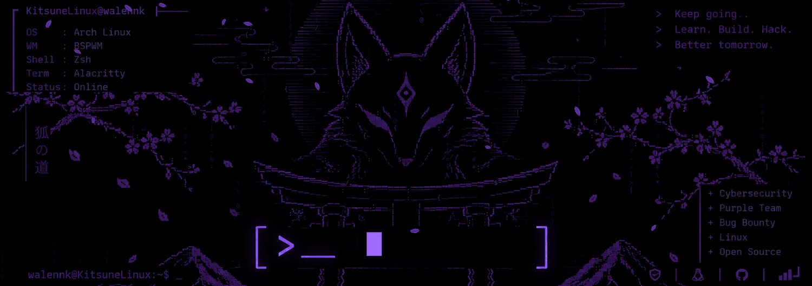
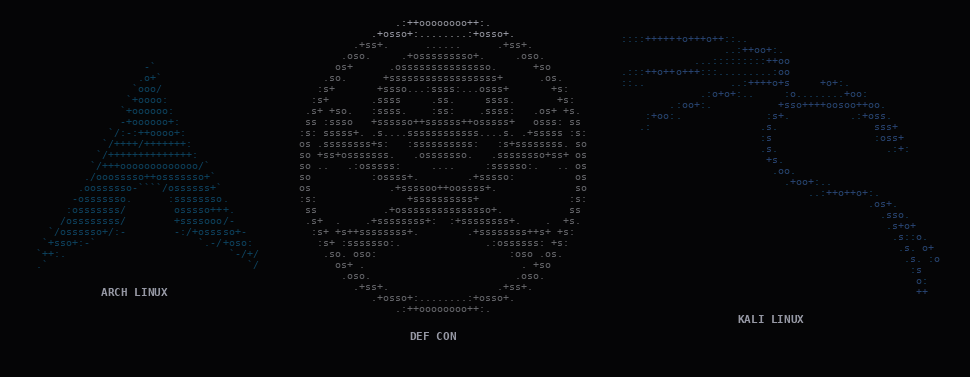

## About

Exploring the paths, trails, and highways of systems, learning from every vulnerability and building things along the way. Curiosity is part of the process.

## Tools

## Labs

## Certifications

## ASCII

## Contact

